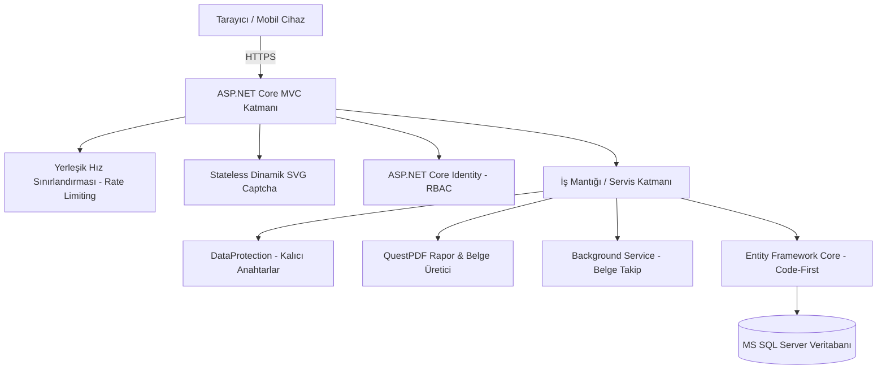

# DÜZCE ÜNİVERSİTESİ ARAÇ TAKİP VE GÖREVLENDİRME SİSTEMİ
## KAPSAMLI PROJE GELİŞTİRME VE FAALİYET RAPORU

> **Proje Sahibi:** Eslem Pekdemir  
> **Kurum:** Düzce Üniversitesi Bilgi İşlem Daire Başkanlığı (Staj Projesi)  
> **Teknoloji Yığını:** .NET 9 (C#), ASP.NET Core MVC, Entity Framework Core (Code-First), MS SQL Server, QuestPDF, Bootstrap 5  
> **Rapor Tarihi:** 09 Ekim 2026  
> **Sistem Durumu:** Canlı / Testleri Tamamlanmış / Üretime Hazır  

---

## 1. YÖNETİCİ ÖZETİ VE PROJE KİMLİĞİ

Düzce Üniversitesi Araç Takip ve Görevlendirme Sistemi, üniversitenin kendi mülkiyetindeki resmi araç filosunun ve görevli şoför kadrosunun operasyonel süreçlerini dijitalleştirmek, şeffaf hale getirmek ve denetlemek amacıyla geliştirilmiş kurumsal bir iç yönetim platformudur.

Sistem, ticari bir araç kiralama veya gelir odaklı bir platform **değildir**; üniversite öz kaynaklarının verimli kullanımını sağlayan bir **rezervasyon, görevlendirme, onay, bakım ve resmi raporlama sistemidir**. Temel misyonu:
> *"Hangi araç, hangi şoförde, ne zaman, hangi resmi görev için, hangi birimin talebiyle kullanılıyor ve aracın muayene/bakım/sigorta durumu nedir?"*

sorularına saniyeler içinde kesin, denetlenebilir ve resmi belgelerle teyitli yanıtlar sunmaktır.

---

## 2. TEKNOLOJİ VE SİSTEM MİMARİSİ



### 2.1 Çekirdek Altyapı Bileşenleri
1. **.NET 9 & ASP.NET Core MVC:** Masaüstü yönetim paneli için klasik MVC + Razor View akışı, şoför mobil operasyonları ve canlı kontroller için AJAX/JSON uç noktaları.
2. **Entity Framework Core (Code-First):** Bütün veritabanı şeması C# varlık sınıfları ve Fluent API konfigürasyonları üzerinden yönetilmektedir. Veri bütünlüğü yabancı anahtarlar (FK), composite index'ler ve kısıtlamalarla garanti altına alınmıştır.
3. **Rol Tabanlı Yetkilendirme (RBAC):**
   - **`Admin` (Bilgi İşlem / Üst Yönetim):** Tam yetki; Araç, Şoför, Görev, Bakım, Talep, Rapor yönetimi, Ulaşım Şefleri yönetimi (`/Sef`) ve sisteme özel denetim günlüğü (`/AuditLog`).
   - **`Kullanici` (Ulaşım Şefi):** Filo operasyon amiri. Araç, şoför, görev, bakım ve talep yönetimi, şoför bildirimlerini onaylama ve doğrudan görev başlatma/bitirme. (AuditLog ve Şef oluşturma yetkisi hariçtir).
   - **`Driver` (Şoför):** Sadece kendi görevlerini görüntüleme (yatay yetki kontrolü), gece/mesai dışı kendi başlangıç ve bitiş bildirimini yapma, mobil şifre değiştirme. Yönetim ekranlarına erişim engellenmiştir.
4. **QuestPDF (Resmi Evrak Motoru):** Harici araç veya tarayıcı bağımlılığı olmaksızın kod ile doğrudan vektörel kalitede resmi "Görevlendirme Belgesi" ve 3 farklı kurumsal denetim raporu üretir.
5. **Dinamik SVG Captcha:** Google reCAPTCHA vb. dış servislere bağımlı olmadan, sunucu tarafında rastgele açı, gürültü çizgileri ve 5 karakterli alfasayısal kod ile üretilen yerel SVG güvenlik sistemi.
6. **Arka Plan Servisleri (Hosted Services):** `VehicleDocumentExpirationWorker` günde bir kez ve açılışta çalışarak muayene ve sigortası dolan araçları otomatik olarak tespit eder ve sistem durumunu günceller.
7. **Yerleşik Rate Limiting (Kaba Kuvvet Kalkanı):** Kayan pencere (Sliding Window) ve sabit pencere (Fixed Window) algoritmalarıyla login, parola sıfırlama, talep formu ve captcha yenileme uç noktaları IP bazlı kilitlenir.

---

## 3. VERİTABANI MODELİ VE ENTITY KATMANI

Sistemdeki tüm ana entity'ler (AuditLog hariç) ortak `BaseAuditableEntity` taban sınıfından türetilmiştir:

```csharp
public abstract class BaseAuditableEntity
{
    public int Id { get; set; }
    public DateTime CreatedAt { get; set; }
    public string CreatedBy { get; set; } = string.Empty;
    public DateTime? UpdatedAt { get; set; }
    public string? UpdatedBy { get; set; }
    public bool IsDeleted { get; set; } = false;
}
```

### 3.1 Temel Varlıklar (Entities)
| Varlık (Entity) | Açıklama | Kritik Kısıtlamalar & Alanlar |
|---|---|---|
| **`ApplicationUser`** | Identity kullanıcı hesabı | `FullName`, `ProfilePictureUrl`, `IsActive`, `CreatedAt`. `App_Data/DataProtection-Keys` ile oturum kalıcılığı. |
| **`Driver`** | Kurumsal Şoför profili | `UserId` (1-1 ilişki), `LicenseNumber` (tarihsel tekillik), `LicenseClass`, `LicenseExpiryDate`, `Department`. |
| **`Vehicle`** | Kurumsal Araç künyesi | `PlateNumber` (tarihsel tekillik), `Brand`, `Model`, `Year`, `CurrentKm` (salt okunur), `Status` (durum makinesi), `InspectionStartDate/ExpiryDate`, `InsuranceStartDate/ExpiryDate`, `TireBrand/Year/Season`, `FineNotes`. |
| **`Assignment`** | Görevlendirme çekirdeği | `VehicleId`, `DriverId`, `PlannedStartTime/EndTime`, `ActualStartTime/EndTime`, `StartKm/EndKm`, `Status`, Onay bayrakları (`StartReportedBySelf`, `EndReportedBySelf`, `*ApprovedByUserId`), `HourlyRate`, `TotalDriverFee`, `Accommodation*`, `PerDiem*`, `SignedDocumentPath`. |
| **`Maintenance`** | Bakım ve onarım kaydı | `VehicleId`, `MaintenanceType`, `Description`, `StartDate`, `EndDate`, `PerformedBy`. |
| **`VehicleRequest`** | Dış personel araç talebi | `RequesterFullName`, `RequesterEmail` (`@duzce.edu.tr` zorunlu), `RequesterPhone`, `Department`, `Purpose`, `Status`, `FulfilledAssignmentId`. |
| **`AuditLog`** | Değiştirilemez denetim izi | `EntityName`, `EntityId`, `Action`, `ChangedByUserId` (nullable), `ChangedAt`, `OldValues` (JSON), `NewValues` (JSON). |

### 3.2 Global Query Filter & Soft-Delete Mekanizması
Veritabanından hiçbir araç, şoför veya görev fiziksel (`DELETE`) olarak silinmez. `IsDeleted = true` bayrağı atanır. `ApplicationDbContext.OnModelCreating` içerisinde otomatik devreye giren Global Query Filter sayesinde silinmiş kayıtlar tüm normal sorgulardan otomatik gizlenir. Ancak plaka ve ehliyet tekilliği denetlenirken `IgnoreQueryFilters()` kullanılarak tarihsel çakışmaların önüne geçilir.

---

## 4. GELİŞTİRİLEN MODÜLLER VE İŞ MANTIKLARI

### 4.1 Kimlik Doğrulama, Profil ve Güvenlik
- **Özelleştirilmiş Login (`/Account/Login`):** Standart Identity sayfaları yerine üniversite kurumsal kimliğine uygun özel Razor View tasarımı.
- **Dinamik SVG Captcha:** Formda `CaptchaToken` gizli alanı yer alır. ASP.NET Core `IDataProtector` ile şifrelenen token 3 dakika geçerlidir. OCR botlarına karşı harf dönüşü ve arka plan çizgileri içerir.
- **Kaba Kuvvet (Brute-Force) Kilidi:** 5 hatalı şifre denemesinde hesap 15 dakika boyunca kilitlenir.
- **Profil Yönetimi ve Bağımsız Parola Akışı (`/Account/Profile`):** Kullanıcı şifre girmeden yalnızca Ad Soyad, E-posta, Telefon ve Profil Fotoğrafını güncelleyebilir.
- **Dinamik Baş Harf (Rozet) Avatar Sistemi:** Profil fotoğrafı olmayan veya fotoğrafını kaldıran tüm kullanıcılarda ad ve soyadın baş harflerinden (`AY`, `SY`, `EŞ`) kurumsal lacivert degrade rozet avatar üretilir.
- **Magic Number Dosya Doğrulaması:** Profil fotoğrafları ve imzalı evrak yüklemelerinde dosya uzantısına veya MIME türüne güvenilmez; dosyanın ilk baytları okunarak gerçek JPEG, PNG veya WebP olup olmadığı sunucuda denetlenir. Yükleme boyutları 5 MB ve 10 MB ile sınırlandırılmıştır.

### 4.2 Araç Yönetimi ve Otomatik Belge Geçerlilik Takibi (`/Vehicle`)
- **Tarihsel Plaka Tekilliği:** Silinmiş bir araç plakası dahi mükerrer açılamaz.
- **Salt-Okunur Koruması:** `CurrentKm` ve `Status` alanları düzenleme formunda kilitlidir; yalnızca görev tamamlandığında şoför ve şef onayıyla güncellenir.
- **`VehicleStatus` Durum Makinesi:** `Boşta` (`Idle`), `Görevde` (`OnDuty`), `Bakımda` (`Maintenance`), `Belgesi Geçersiz` (`DocumentExpired`), `Hizmet Dışı` (`OutOfService`).
- **Otomatik Muayene & Sigorta Takip Motoru:**
  - Fenni muayene veya trafik sigortası dolan araçlar arka plan servisi (`VehicleDocumentExpirationWorker`) ve görev atama kontrolü sırasında anında `DocumentExpired` durumuna alınır ve göreve verilmesi engellenir.
  - Seyir halindeki (`OnDuty`) araçların görevi bölünmez; görev bittiğinde kontrol devreye girer.
  - Tarihler güncellenip geçerli hale getirildiğinde durum otomatik olarak `Boşta`ya geri döner.

### 4.3 Şoför Yönetimi (`/Driver`)
- **İlişkili Hesap Yönetimi:** Yeni şoför eklenirken `ApplicationUser` (Identity hesabı) ve `Driver` profili tek bir veritabanı işlemi (Transaction) içinde oluşturulur.
- **Tek Tıkla Aktif/Pasif (`ToggleStatus`):** Aktif görevi olmayan şoför pasife alındığında `ApplicationUser.IsActive = false` senkronize edilir ve sisteme girişi derhal kesilir.
- **Ehliyet Süresi Kontrolü:** Ehliyet geçerlilik tarihi, atanmak istenen görevin planlanan bitiş tarihinden önce bitiyorsa sistem görev atamasını reddeder.

### 4.4 Ulaşım Şefleri Yönetimi (`/Sef`)
- Sadece `Admin` rolündeki kullanıcıların erişebildiği bu ekranda Ulaşım Şefi (`Kullanici`) hesapları yönetilir.
- `@duzce.edu.tr` e-posta zorunluluğu bulunur.
- Soft-delete uygulanarak geçmiş denetim kayıtlarındaki ilişkiler (`AuditLog.ChangedByUserId`) korunur. Admin'in kendi hesabını pasife alması engellenmiştir.

### 4.5 Görevlendirme ve 3 Kademeli Onay Akışı (`/Assignment`)
Sistemin en kritik çekirdek modülüdür:
1. **Çifte Rezervasyon Koruması:** Bir araç veya şoför için seçilen `PlannedStartTime - PlannedEndTime` aralığında çakışan başka bir aktif/planlı görev varsa kayıt engellenir.
2. **Canlı Müsaitlik Kontrolü (`/Availability`):** Form doldurulurken AJAX ile araç ve şoförün boşta olup olmadığı, bakımda olup olmadığı ve ehliyet süresi anında doğrulanır.
3. **Gece / Mesai Dışı Şoför Bildirim Senaryosu:**
   - Şoför mesai saati dışında göreve çıktığında mobil panelden **"Başlangıcı Bildir"** der. Başlangıç KM'si ve saati kaydedilir, `StartReportedBySelf = true` olur; ancak görev hemen `InProgress`'e geçmez, şef ekranında **"⏳ Onay Bekliyor"** olarak işaretlenir.
   - Şoför gece döndüğünde şef henüz onaylamamış olsa bile **"Bitişi Bildir"** yapabilir.
   - Şef sabah sisteme girdiğinde tek tıkla bildirimi onaylar (`ApproveStart` / `ApproveEnd`); araç KM'si güncellenir ve görev resmi olarak tamamlanır.
4. **Şefin Doğrudan Başlatma/Bitirmesi (`StartDirect` / `EndDirect`):** Şoförün akıllı telefonu olmaması veya internet erişimi bulunmaması durumunda Şef kendi ekranından görevi başlatıp bitirebilir.
5. **Seyir Halindeki Görevlerde Süre Uzatma (`ExtendDuration`):**
   - Yol çalışması veya hava muhalefeti gibi durumlarda görev detayından **"Süreyi Uzat"** modalı açılır.
   - Yeni bitiş tarihine kadar aracın/şoförün başka görevi olup olmadığı denetlenir.
   - Uzatma gerekçesi görev notlarına `[Süre Uzatma - dd.MM.yyyy HH:mm]: {gerekçe}` şeklinde damgalanır ve `AuditLog` oluşturulur.
6. **İmzalı Evrak Arşivi (`/Assignment/SignedDocuments`):**
   - Islak imzalı resmi görev kağıtlarının taranmış halleri sisteme yüklenir.
   - Dosyalar `App_Data/AssignmentDocuments` altında web erişimine kapalı tutulur; yalnızca yetkili kullanıcılar `DownloadSignedDocument` üzerinden güvenle indirebilir.
   - Arşiv ekranında plaka, şoför, tarih filtreleri ve canlı arama bulunur.

### 4.6 Finansal Model ve Görev Ücreti Standartları
- **Terminoloji Temizliği:** Eski "Kadrolu Personel" ve "Yevmiye" ayrımı tamamen kaldırılmış; tüm şoförler üniversitenin resmi personeli olarak ele alınmıştır. Formlar ve raporlarda **"Görev Ücreti"**, **"Saatlik Ücret"** ve **"Harcırah"** standartlaştırılmıştır.
- **Görev Ücreti Hesabı:** Görev tamamlanırken Şef tarafından serbestçe girilen saatlik ücret (`HourlyRate`), fiili görev süresi (`CalculatedDutyHours`) ile çarpılarak `TotalDriverFee` hesaplanır.
- **Konaklama ve Harcırah Revizyonu (`UpdateFinancialDetails`):** Görev tamamlandıktan sonra intikal eden otel faturası veya harcırah belgeleri için yalnızca maliyet alanları gerekçeli olarak güncellenebilir; kilometre ve fiili süre kilitli kalır.

### 4.7 Bakım Modülü (`/Maintenance`)
- Görevdeki bir araç bakıma alınamaz; bakımdaki bir araca görev açılamaz.
- Bakım kaydı girildiğinde aracın durumu otomatik `Bakımda` olur; bakım tamamlandığında `Boşta`ya döner.
- Bakım kaydı soft-delete ile silindiğinde aracın durumu güvenli şekilde düzeltilir.

### 4.8 Anonim Personel Araç Talebi (`/AracTalebi` & `/VehicleRequest`)
- Sisteme giriş yapmadan üniversitenin akademik ve idari personeli ad, soyad, `@duzce.edu.tr` e-posta, telefon, birim/fakülte (`<datalist>` otomatik tamamlama) ve gerekçe ile araç talep edebilir.
- Şef veya Admin gelen talebi inceler; tek tıkla **"Karşıla"** diyerek uygun araç ve şoförü seçip göreve dönüştürür.
- Talep sahibine kurumsal e-posta ile bildirim (Development ortamında konsol simülasyonu, Production'da SMTP) iletilir. Reddedilme durumunda gerekçeli ret maili gider.

### 4.9 Resmi Rapor Merkezi ve PDF Üretimi (`/Report`)
QuestPDF kütüphanesi ile üretilen 3 sekmeli resmi denetim modülü:
1. **Sefer & Kullanım Raporu (`/Report/Index`):** Araç ve şoför bazlı tamamlanan görevlerin dökümü, toplam kilometre, sefer adedi ve görev ücretleri özeti + Resmi PDF çıktısı.
2. **Bakım & Maliyet Raporu (`/Report/Maintenance`):** Tarih ve SAAT (`datetime-local`) bazlı detaylı servis, tamir ve parça maliyet dökümü + Saat bilgili PDF çıktısı.
3. **Sigorta & Muayene Takip Raporu (`/Report/InsuranceInspection`):** Filo geneli, süresi geçenler veya 30 gün içinde dolacak belgelerin renkli kurumsal dökümü + PDF çıktısı.

### 4.10 Yönetici Dashboard (`/Home/Index`)
- **4 Büyük KPI Kartı:** Filo toplam araç durumu, aktif seyirdeki görevler, bugünkü planlar, servisteki araçlar.
- **Filo Durumu Pasta Grafiği:** Chart.js ile 5 durumu (Boşta, Görevde, Bakımda, Belgesi Geçersiz, Hizmet Dışı) kurumsal renklerle görselleştirme.
- **Hızlı Plaka Arama (AJAX):** Plaka yazıldığında aracın anlık durumu, sigorta/muayene tarihi, şef notu ve son görev yapan şoförünü açılır kartta gösterme.
- **Akıllı Bildirim Çanı & Toast:** Bekleyen araç talepleri ve süresi yaklaşan muayeneler için AJAX ile çan rozeti, ilk girişte Web Audio kurumsal ses ve Bootstrap Toast bildirimi. `sessionStorage` imza kontrolü ile bildirim spam'i engellenir.

### 4.11 Şoför Mobil Paneli (`/Surucu`)
- Masaüstü tabloları yerine %100 dokunmatik mobil kart (`card`) tasarımı.
- Başparmak erişimine uygun en az 48px yüksekliğinde **"Başlangıcı Bildir"** ve **"Bitişi Bildir"** butonları.
- Yatay yetki kontrolü ile şoförün yalnızca kendi görevlerini görebilmesi.
- Mobil uyumlu ilk giriş şifre değiştirme ekranı (`/Surucu/ChangePassword`).

### 4.12 Denetim Günlüğü (`/AuditLog`)
- Sadece `Admin` rolüne açık, değiştirilemez denetim kaydı.
- KM değişiklikleri, görev iptalleri, durum geçişleri, süre uzatmaları ve finansal revizyonlar JSON eski/yeni değerlerle kaydedilir.
- "İncele" modalında teknik terimler yerine tamamen Türkçe kullanıcı dostu etiketler gösterilir.

---

## 5. GERÇEKLEŞTİRİLEN DOĞRULAMA VE TEST FAALİYETLERİ

Proje boyunca yazılan ve `scratch/` klasöründe yer alan 68 adet PowerShell otomasyon testi ile aşağıdaki senaryolar uçtan uca denenmiş ve doğrulanmıştır:

| Test Alanı | Test Edilen Senaryolar | Sonuç |
|---|---|---|
| **Kimlik & Yetkilendirme** | Admin, Şef, Şoför girişleri, rol yönlendirmeleri, 5 hatalı şifrede kilitlenme, yatay yetki izolasyonu, 404 Register kontrolü | **BAŞARILI** (12/12) |
| **SVG Captcha** | Görsel üretimi, token şifreleme, tek tıkla yenileme, hatalı kodda form reddi, süre aşımı (TTL) testi | **BAŞARILI** (5/5) |
| **Araç Envanteri** | Plaka tekilliği, soft-delete sonrası tekrar plaka ekleme yasağı, KM/Durum salt-okunurluğu, muayene dolunca otomatik kırmızıya dönme ve düzelince geri gelme | **BAŞARILI** (8/8) |
| **Şoför Yönetimi** | Yeni şoför açma, ehliyet tekilliği, aktif görevli şoförü silememe/pasife alamama, pasif şoförün girişinin kesilmesi | **BAŞARILI** (6/6) |
| **Görev & Çakışma** | Çifte rezervasyon engeli, ehliyet süresi yetersiz şoföre görev verememe, bakımdaki aracı seçememe | **BAŞARILI** (7/7) |
| **3 Kademeli Onay** | Şoför gece başlangıç/bitiş bildirme, şef ekranında onay bekliyor rozeti, onaylama anında KM güncelleme, şef doğrudan başlatma/bitirme | **BAŞARILI** (8/8) |
| **Süre Uzatma** | InProgress görevde uzatma modalı, çakışma durumunda reddedilme, `ExpenseNotes` damgası ve AuditLog izi | **BAŞARILI** (4/4) |
| **Evrak & Belge** | QuestPDF görev belgesi indirme, imzalı evrak yükleme, 11MB ve sahte uzantılı zararlı dosya reddi, arşiv listeleme ve filtre temizleme | **BAŞARILI** (6/6) |
| **Bakım Modülü** | Bakıma alma, araç durumunun Maintenance olması, ikinci bakım engeli, bakım bitince Idle'a dönüş, silme güvenliği | **BAŞARILI** (5/5) |
| **Araç Talepleri** | Girişsiz talep gönderme, `@duzce.edu.tr` regex doğrulaması, fakülte seçimi, Şef tarafından göreve dönüştürme ve e-posta bildirimi | **BAŞARILI** (6/6) |
| **Raporlama & PDF** | Sefer raporu, Bakım raporu (saat filtreli), Sigorta raporu, sekme geçişleri ve PDF indirmeleri | **BAŞARILI** (6/6) |
| **Dashboard & Bildirim** | KPI kartları, 5 renkli filo grafiği, plaka arama, Web Audio sesi, Toast bildirimi ve `sessionStorage` spam engeli | **BAŞARILI** (6/6) |
| **Mobil Standartlar** | 48px dokunmatik butonlar, tek sütun kartlar, yatay kaydırma olmaması, mobil şifre değiştirme | **BAŞARILI** (4/4) |
| **Profil & Güvenlik** | Şifresiz profil güncelleme, dinamik rozet avatar (`AY`, `SY`), canlı görsel önizleme, Magic number doğrulaması, fotoğraf kaldırma | **BAŞARILI** (7/7) |
| **Terminoloji** | "Kadrolu Personel" ve "Yevmiye" ibarelerinin tüm kod tabanından temizlendiğinin regex doğrulaması | **BAŞARILI** (1/1) |
| **Decimal Binder** | Hem virgüllü (250,50) hem noktalı (250.50) tutarların hatasız model bind edilmesi | **BAŞARILI** (1/1) |

---

## 6. PROJE DİZİN VE DOSYA ENVANTERİ

```
aractakipsys/
├── Controllers/              (12 Controller - Account, Assignment, AuditLog, Availability, Driver, Home, Maintenance, Report, Sef, Surucu, Vehicle, VehicleRequest)
├── Data/                     (ApplicationDbContext, DbInitializer - Seed Data)
├── Migrations/               (16 Migration Adımı - InitialCreate'den güncel hibrit harcırah modeline)
├── Models/
│   ├── Entities/             (BaseAuditableEntity, ApplicationUser, Driver, Vehicle, Assignment, Maintenance, VehicleRequest, AuditLog)
│   ├── Enums/                (VehicleStatus, VehicleType, FuelType, AssignmentStatus, TireSeason, VehicleRequestStatus, AuditAction, vb.)
│   └── ViewModels/           (11 Modül Klasörü - Create, Edit, Details, List, Filter, AjaxResult ViewModelleri)
├── Services/
│   ├── Interfaces/           (IAssignmentService, IVehicleService, IDriverService, IMaintenanceService, IReportService, ICaptchaService, IEmailService, vb.)
│   ├── Implementations/      (AssignmentService, VehicleService, DriverService, MaintenanceService, ReportService, CaptchaService, QuestPDF Doküman Sınıfları)
│   └── BackgroundServices/   (VehicleDocumentExpirationWorker - 24 saatlik Hosted Service)
├── Common/                   (ModelBinders - InvariantDecimalModelBinder, Helpers - AvatarHelper)
├── Views/                    (12 Görünüm Klasörü + _AdminLayout + _SurucuLayout)
├── wwwroot/                  (Kurumsal CSS, JS, Bootstrap 5, FontAwesome, Chart.js, Select2)
└── App_Data/                 (DataProtection-Keys, AssignmentDocuments - Güvenli fiziksel depolama)
```

---

## 7. SONUÇ VE TESLİM DEĞERLENDİRMESİ

Düzce Üniversitesi Bilgi İşlem Daire Başkanlığı standartlarına tam uyumlu olarak geliştirilen **Araç Takip ve Görevlendirme Sistemi**;
- Yüksek güvenlik mimarisi (Magic number denetimi, DataProtection, yerleşik Rate Limiting, Brute-force koruması, Stateless Captcha),
- Güçlü veri bütünlüğü (Tarihsel plaka/ehliyet tekilliği, soft-delete, çifte rezervasyon engeli, otomatik belge takip motoru),
- Gerçek saha koşullarına uygun operasyonel esneklik (Gece mesai dışı şoför bildirimleri, 3 kademeli şef onay mekanizması, seyir halinde süre uzatma),
- Resmi kurumsal standartlar (QuestPDF resmi görev emri ve denetim raporları, dinamik rozet avatarlar, mobil-first şoför paneli, üniversite personeli talep formu),

özellikleriyle eksiksiz, kararlı ve üretime hazır şekilde tamamlanmıştır.
